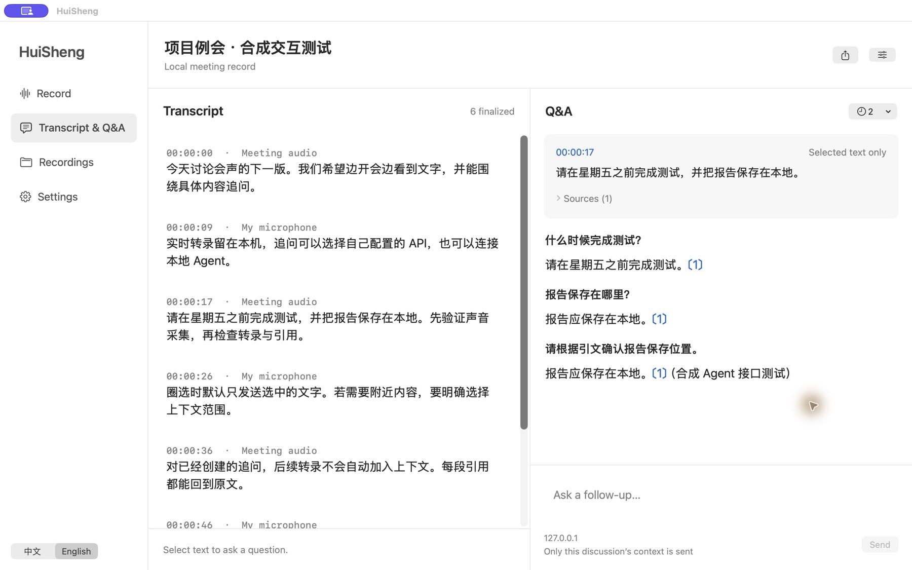
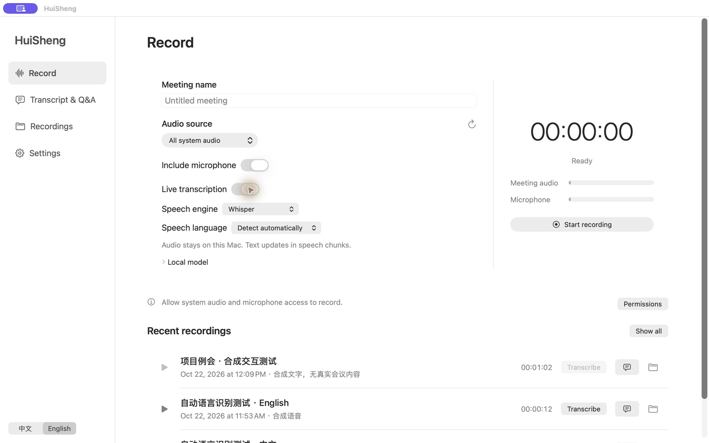

<p align="center"></p>
<h1 align="center">HuiSheng · 会声</h1>
<p align="center">Local meeting recording, live transcription, and selection-based follow-up questions.</p>
<p align="center"><strong>English</strong> · <a href="README.zh-CN.md">简体中文</a></p>

Record meeting audio and your microphone as M4A, transcribe on your Mac, then select text to ask follow-up questions beside the transcript. Answers can come from your own API, an on-device model, or a local agent. Recording and transcription require no API key or virtual audio driver.

**Early preview:** v0.4 adds local Whisper with automatic language detection, optional live transcription, transcription of saved recordings, and automatic discovery of installed agents. The native interface keeps larger type and instant Chinese / English switching. Screen recording and speaker identification are not included.



*Interface example: synthetic transcript and mock answers, not a real meeting or model evaluation.*

## Features

- Capture all system audio or select a running application.
- Include your default microphone, with separate input level indicators.
- Pause and resume without leaving a pause-length gap in the saved recording.
- Save a mixed M4A file and keep original audio tracks for recovery.
- Browse, search, play, and reveal recordings in Finder.
- Control an active recording from the menu bar while the main window is closed.
- Choose a local storage folder; no audio is uploaded by the app.
- Optional on-device live transcription, or transcribe saved recordings later.
- Whisper automatic language detection with an installed multilingual model; Apple recognition with a selected language. Timestamps and separate system/microphone labels are retained when original tracks are available.
- Automatically discover installed Codex and Claude Code executables, including Node version-manager installations.
- Native text selection across paragraphs, anchored discussions, follow-up questions, and links back to source text.
- OpenAI-compatible streaming APIs, Ollama / LM Studio endpoints, Codex CLI, and Claude Code.
- Local transcript/discussion persistence, reopening, and Markdown export.

## Requirements

| Item | Requirement |
| --- | --- |
| Operating system | macOS 15 or later |
| Whisper transcription | macOS 15+, a compatible installed `whisper-cli` and multilingual whisper.cpp `ggml-*.bin` model; models are not bundled or downloaded by HuiSheng |
| Apple transcription | macOS 26+, an Apple Silicon Mac supporting SpeechTranscriber; Apple speech assets may need downloading on first use |
| Downloadable build | Apple Silicon / arm64 |
| Permissions | Screen & System Audio Recording; Microphone if enabled |
| Building from source | Apple Command Line Tools or Xcode with the macOS 26 SDK (Swift 6.2+) |

The initial build was tested on macOS 26.5.2 with Swift 6.3.3. Earlier supported macOS versions and Intel Macs have not been tested.

## Install

Download `HuiSheng-v0.4.1-macOS-arm64.zip` from the [v0.4.1 preview release](https://github.com/chenxiachan/HuiSheng/releases/tag/v0.4.1), unzip it, and move `会声-v0.4.1.app` to Applications.

This preview is ad-hoc signed and **not notarized by Apple**. macOS may block a downloaded build; building from source is the alternative for this release.

## Interface language

Use **中文 / English** at the bottom of the sidebar, or **Settings → Interface language**. Changes apply immediately and persist after restart. Speech language is a separate recording option. Switching the interface does not translate or replace meeting text, selected passages, or existing answers. System-managed dialogs and standard macOS menus may follow the system language.

The interface uses system colors and appearance, 16 pt main interface text, and 18 pt transcript and answer text. Recording guidance and context-sharing details are available in disclosures instead of persistent banners.

## Record a meeting

1. Open your meeting client and join the meeting.
2. In HuiSheng, choose **All system audio**, or select the meeting application.
3. Turn **Include microphone** on or off before recording.
4. Click **Start recording**. Allow the requested permissions in **System Settings → Privacy & Security**. If capture still fails after permission is granted, quit and reopen HuiSheng.
5. Check the meeting and microphone level indicators. Pause or resume as needed, then click **Stop & Save**.

Turn **Live transcription** on or off before recording. If off, audio is saved normally and can be transcribed later. Choose **Whisper → Detect automatically** to recognize the language locally, or choose Apple and a specific language. Recording begins after preparation; preparation can be cancelled. A transcription failure is displayed and recording continues independently.

Recordings are saved to `~/Movies/会声` by default. Change the destination in Settings. Each meeting has its own folder with a final `.m4a` file, original tracks, `session.json` metadata, and a `meeting.json` transcript/discussion document. The library shows recordings in the selected storage folder.

| Shortcut | Action |
| --- | --- |
| `⌘ ⇧ R` | Start / stop and save |
| `⌘ ⇧ P` | Pause / resume |
| `⌘ ⇧ O` | Open the recording folder |

## Live transcription and anchored questions

1. Start recording and open **Transcript & Q&A**. Whisper updates in speech chunks (typically 8–20 seconds plus inference time); Apple provides provisional text labeled “Draft,” which can also be selected and finalizes naturally. Whisper flushes a short final chunk when recording stops.
2. Drag to select a sentence or text across paragraphs. The default is **selected text only**; explicitly choose nearby paragraphs (two on each side) or all currently available text if needed.
3. Click **Ask about selection** and ask in the right pane. Configure the answer backend using the settings button first.
4. Continue the discussion around the same quotation. Its evidence is a fixed snapshot; new transcript content never expands that discussion automatically. Discussions containing provisional text are labeled; later corrections do not rewrite their original quotations. Expand the evidence disclosure to inspect the actual material.
5. Click a citation or evidence item to return to its paragraph. Stopping preserves received text, but incomplete answers are excluded from subsequent request history. Export the transcript and discussions as Markdown from the toolbar.

The displayed transcript stays fixed during selection while capture and recognition continue; clearing the selection or creating a discussion resumes display updates. System/microphone labels identify input tracks, not participants. Transcripts can contain recognition errors; timestamps refer to paragraph ranges. Review important details against the recording.

### Local speech models and automatic language detection



HuiSheng detects an installed `whisper-cli` through the terminal PATH, common install directories, and Node version-manager directories. It looks for multilingual `ggml-*.bin` files in known model folders, including `~/Documents/whisper.cpp/models`, `~/whisper.cpp/models`, and `~/Library/Application Support/HuiSheng/models`. No model is downloaded automatically. Expand **Local model** to select another model or executable. On a fresh setup, Whisper with automatic detection is the default when both are found; otherwise Apple is selected.

Whisper uses `-l auto` without translating the text. The engine detects the predominant language for each live chunk, or for a saved audio track. This is not word-by-word language switching: mixed languages, silence, noise, or very short phrases may reduce accuracy. Choose Chinese, English, or German explicitly when needed. English-only `.en.bin` models cannot be used for automatic detection. Apple requires a selected language and does not offer automatic detection here.

### Transcribe a saved recording

In **Recordings**, click **Transcribe**, choose the engine and language, then **Start transcription**. A progress indicator and cancellation control are shown. The app prefers complete original tracks; if they are unavailable, it uses the mixed recording and cannot separate the speakers or input sources. WAV conversion, recognition, and temporary-file cleanup happen locally; allow additional temporary disk space (roughly 115 MB per hour per converted mono track).

Completed text opens in **Transcript & Q&A**. Cancelling or failing leaves audio and existing text unchanged. Existing text without discussions can be transcribed again; its previous `meeting.json` is backed up in the recording folder. Transcripts with linked discussions cannot currently be replaced, to preserve their citation targets. Arbitrary external audio import is not included in this version.

### APIs, on-device models, and local agents

| Backend | Setup | Output |
| --- | --- | --- |
| OpenAI-compatible API | Base URL including `/v1` or the provider path, model name, and key; uses `chat/completions` | Streaming |
| Ollama / LM Studio | Start the local server, download a model, select the URL preset, and enter the installed model name | Streaming; can operate fully offline |
| Codex CLI / Claude Code | Install and sign in through the terminal; HuiSheng discovers the executable automatically. Manual selection and model name are optional | Shown on completion; cancellable, 180-second timeout |

Use **Scan again** after installing a CLI. Discovery follows the approach used in ThoughtDAG and TextFold: terminal PATH, standard locations, NVM/FNM, and other version managers. Child processes receive the expanded PATH so Node-based commands also work when HuiSheng is opened from Finder. Custom executable paths remain available under **Agent path**.

API keys are stored in macOS Keychain per endpoint, never in meeting files. HTTP is permitted only for loopback hosts; other endpoints require HTTPS. Redirects are refused. Evidence above 40,000 characters or a discussion above 80,000 characters requires a smaller scope.

Agents run in a separate temporary directory with prompts on standard input, without shell interpolation. Codex uses an ephemeral read-only session, disables shell/web search, plugins, app tools, subagents and host skill discovery, and ignores user configuration, rules, and project documents. Claude uses safe mode, no tools, an empty MCP configuration, and no session persistence. The installed CLI must support these flags; incompatible versions fail explicitly. Flags were checked against local Codex CLI 0.153.4 and Claude Code 2.1.308 help. The CLI uses its own existing authentication; HuiSheng does not copy another application's credentials. Use the compatible API option for custom CLI providers.

**A local agent is not necessarily an offline model.** Codex and Claude can still contact their cloud providers. HuiSheng supplies only explicitly selected evidence and completed history for this discussion; the service/CLI's own data-handling behavior also applies. Connect an on-device model when fully offline Q&A is required.

## Tencent Meeting, Teams, Zoom, and browser meetings

HuiSheng captures audio through Apple's **ScreenCaptureKit**. It does not require a meeting plugin or use the conferencing service's cloud recording API. The intended capture path for Tencent Meeting, VooV Meeting, Microsoft Teams, Zoom, and browser meetings is the audio they play on the Mac.

- **All system audio** also includes music, notifications, and other applications.
- **Application mode** filters the selected app and helper processes with matching bundle-ID prefixes. Some clients route audio through other processes; if the meter stays silent, try all system audio.
- For a web meeting, select the **browser**. Individual browser tabs cannot be isolated.

Real calls in Tencent Meeting, Teams, and Zoom have **not yet been individually verified**. Check both audio meters and make a short test recording before relying on the app for a meeting.

## Recording behavior and privacy

- Tell participants before recording. HuiSheng does not send an in-meeting recording notification.
- Use headphones to avoid capturing speaker audio again through the microphone. Acoustic echo cancellation is not included.
- **The meeting client's mute button does not mute HuiSheng's microphone.** Disable microphone capture in HuiSheng before starting if you only want the meeting audio.
- Keep the Mac awake with its lid open. Sleep, permission changes, and audio-device changes may interrupt capture; check the meters after switching devices.
- Audio processing and file export happen locally. If you choose a folder synchronized by iCloud, Dropbox, or another service, that service may sync the files independently.
- Starting requires about 512 MiB of free space. The app attempts to stop and save if available space drops below about 100 MiB. Export also requires additional space.
- Original tracks remain after export, so storage use exceeds the final M4A size. Manage files in Finder.
- After an interruption, **Recover export** can attempt to rebuild a recording from readable original tracks. Recovery after a crash or power loss is not guaranteed.

## Build from source

```bash
git clone https://github.com/chenxiachan/HuiSheng.git
cd HuiSheng
bash scripts/build-app.sh "$PWD/dist/会声.app"
open "dist/会声.app"
```

The script builds the Swift package in release mode, generates the app icon, creates the app bundle, and applies an ad-hoc signature. There are no third-party package dependencies. `HUISHENG_BUILD_DIR` can override the default `.build` directory.

## Run verification

```bash
bash scripts/test.sh
```

The standalone runner works with Command Line Tools; a full Xcode installation is not required. It uses synthetic audio and does not access the microphone or screen. Five checks cover:

1. Pause removal and rejection of stale samples.
2. A pause before the first audio sample.
3. Safe recording filenames and duration formatting.
4. Encoding, mixing, export, and decoding of 48 kHz stereo and delayed 44.1 kHz mono inputs, with frequency checks before and after a pause.
5. Empty-input export failure without a final output file.

Additional checks cover persisted interface-language switching, legacy scope labels, unchanged quotation snapshots and UTF-16 selection across languages, native UTF-16 selection, selection-only isolation, evidence snapshots, restart recovery, real loopback HTTP/SSE with split UTF-8, interrupted responses, HTTP 401, redirects, model errors, cancellation, and simulated CLI input/output and termination. Mock backends do not invoke real models.

Run the optional Whisper / Apple file-transcription and Whisper live integration check with installed models (synthetic Chinese/English voices only; `WHISPER_CLI` and `WHISPER_MODEL` can override discovery):

```bash
bash scripts/local-speech-check.sh
```

Run the opt-in Apple live speech integration check on macOS 26+ (Apple models may download on first use; requires the system Tingting and Samantha voices):

```bash
bash scripts/speech-check.sh
```

v0.4 was verified with actual local Whisper automatic Chinese/English recognition, two simultaneous live input formats, updates before stopping, file transcription, cancellation, and Apple file transcription. The native app was checked in both interface languages, including discovered agents and selecting text from a newly generated transcript. These checks used synthetic audio and did not invoke an agent model.

v0.4 adds regression checks for sparse-PATH agent discovery, version-manager ordering, child-process runtime discovery, Whisper timestamps, English-only model rejection, recording source fallback, backup creation, and protection against overwriting changed or cited transcripts.

v0.3 was checked in native windows in both interface languages, including immediate menu refresh, preserved text selection and question history, settings sheets, and language persistence after restart.

v0.2 was checked on this Mac with actual Chinese/English synthesized-speech recognition, both input tracks, live provisional updates, native selection, API/mock-agent discussions, and reopening history. German accuracy, real cloud-model responses, signed-in CLI model answers, long dual-track recordings, and individual meeting platforms have not been fully validated.

Test artifacts are written to `.test-output/`, or the directory set by `HUISHENG_TEST_OUTPUT_DIR`. Long meetings, audio-device hot-swapping, sleep, and crash recovery still need broader real-world testing.

## How it works

`ScreenCaptureKit → separate AAC tracks → shared timeline → local M4A mix`

After recording writes, a separate queue feeds PCM conversion into Apple SpeechAnalyzer / SpeechTranscriber or bounded WAV chunks for the installed whisper.cpp CLI. Saved recordings use AVAssetReader conversion and the same local engines. Timestamped text becomes fixed selection evidence for API/CLI requests. Backpressure or recognition errors stop transcription with a visible warning while keeping recording independent. Transcript and discussion updates are written atomically to `meeting.json`.

SwiftUI and AppKit provide the interface and menu-bar controls. A serial media queue handles capture, pause, and stop operations. AVAssetWriter encodes separate system and microphone tracks; AVMutableComposition and AVAudioMix export the final recording. With two audio tracks, each uses a gain of 0.5 to leave mixing headroom.

Original tracks use fragmented MOV containers. Final exports are written to a temporary file before being moved into place; session metadata is written atomically. In audio-only mode, screen samples are discarded and never passed to a file writer.

See Apple's [ScreenCaptureKit documentation](https://developer.apple.com/documentation/screencapturekit) and [microphone capture walkthrough](https://developer.apple.com/videos/play/wwdc2024/10088/) for the underlying APIs.

Speech implementation reference: [Apple SpeechAnalyzer](https://developer.apple.com/documentation/speech/speechanalyzer).
