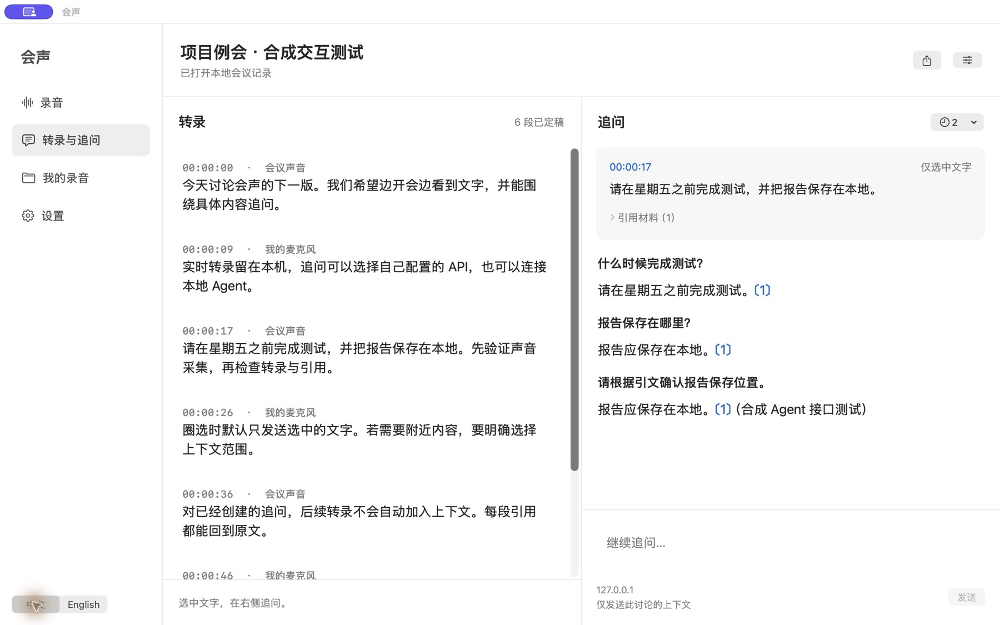

<p align="center"></p>
<h1 align="center">会声 · HuiSheng</h1>
<p align="center">本地会议录音、实时转录与选段追问。</p>
<p align="center"><a href="README.md">English</a> · <strong>简体中文</strong></p>

会声将会议声音和麦克风一起录制为 M4A，并在本机实时识别文字。圈选转录后，可以在右侧连续追问；回答可来自你配置的 API、本机模型或本地 Agent。录音和转录无需 API 密钥或虚拟声卡。

**早期预览版：**v0.3 改为更简洁的 macOS 原生界面，整体字号增大，支持中英文即时切换。保留本地录音、实时转录与选段追问，不包含录屏或说话人身份识别。



*界面示例使用合成转录与模拟回答，并非真实会议或模型效果评测。*

## 功能

- 录制全部系统声音，或选择一个正在运行的应用。
- 可同时录入系统默认麦克风，分别显示会议和麦克风输入音量。
- 支持暂停与继续，保存的录音不包含暂停期间的空白。
- 导出混合后的 M4A，同时保留原始音轨供恢复使用。
- 浏览、搜索、回听录音，以及在访达中定位文件。
- 关闭主窗口后，可从菜单栏管理正在进行的录音。
- 自选本地保存位置；应用不上传音频。
- 中文、英文、德文的本地实时转录，区分「会议声音」与「我的麦克风」，保留时间戳。
- 原生文字圈选、跨段选择、固定引用、多轮追问，以及引用回到原文。
- 支持 OpenAI 兼容流式 API、Ollama / LM Studio 本机接口、Codex CLI 和 Claude Code。
- 自动保存转录与追问，可重新打开并导出 Markdown。

## 系统要求

| 项目 | 要求 |
| --- | --- |
| 操作系统 | macOS 15 或更新版本 |
| 本地实时转录 | macOS 26+、支持 SpeechTranscriber 的 Apple Silicon Mac；首次使用可能需下载 Apple 语音组件 |
| 预编译安装包 | Apple Silicon / arm64 |
| 系统权限 | 屏幕与系统音频录制；启用麦克风时还需麦克风权限 |
| 源码构建 | 包含 macOS 26 SDK 的 Apple Command Line Tools 或 Xcode（Swift 6.2+） |

首版在 macOS 26.5.2、Swift 6.3.3 环境验证。尚未实测更早的受支持 macOS 版本或 Intel Mac。

## 安装

从 [v0.3.0 预览版发布页](https://github.com/chenxiachan/HuiSheng/releases/tag/v0.3.0) 下载 `HuiSheng-v0.3.0-macOS-arm64.zip`，解压后将 `会声-v0.3.app` 拖到「应用程序」文件夹。

预览版使用临时签名，**尚未经过 Apple 公证**。macOS 可能拦截下载的应用；本版本也可通过源码在本机构建。

## 界面语言

点击侧栏底部的「**中文 / English**」，或进入「**设置 → 界面语言**」。切换立即生效，重启后保留选择。识别语言是独立的录音选项；界面切换不会翻译或替换会议原文、已选文字及已有回答。系统管理的对话框和标准 macOS 菜单可能仍使用系统语言。

界面使用系统配色与外观，主要界面文字为 16 pt，转录和回答为 18 pt。录音说明、发送上下文说明收进可展开区域。

## 录制会议

1. 打开会议客户端并进入会议。
2. 在会声中选择「**全部系统声音**」，或指定会议应用。
3. 开始前按需开启或关闭「**录入麦克风**」。
4. 点击「**开始录音**」，在「系统设置 → 隐私与安全性」中允许所需权限。如果授权后仍无法采集，请退出并重新打开会声。
5. 确认会议声音与麦克风音量指示有响应。可以暂停、继续，最后点击「**结束并保存**」。

如果启用「实时转录」，先选择识别语言。组件准备完毕后才开始录音；准备期间可以取消。转录失败时录音仍继续，界面会显示错误。

默认保存到 `~/Movies/会声`，可在设置中更改位置。每场会议有独立文件夹，包含最终 `.m4a`、原始音轨、`session.json` 元数据及 `meeting.json` 转录/问答文档。录音列表显示当前所选保存位置中的会议。

| 快捷键 | 操作 |
| --- | --- |
| `⌘ ⇧ R` | 开始 / 结束并保存 |
| `⌘ ⇧ P` | 暂停 / 继续 |
| `⌘ ⇧ O` | 打开录音文件夹 |

## 实时转录与选段追问

1. 开始录音后进入「**转录与追问**」。正文实时更新；尚未定稿的文字标注为「识别中」，也可以圈选提问。识别器自然定稿，不人为截断语句。
2. 拖动圈选一句话或跨段文字。默认范围是「**仅选中文字**」，也可明确改为前后各两段或当前全部转录。
3. 点击「**追问选中内容**」，在右侧输入问题。首次使用先通过右上角设置选择回答方式。
4. 同一条讨论可以连续追问。其引用材料固定为创建时的快照，之后的新转录不会自动加入；含识别中内容的讨论会标注「含未定稿」，原文修正不会改写旧引文；「引用材料」可查看实际范围。
5. 点击引用编号或材料列表可定位原段落。停止回答会保留已收到的文字，但未完成回答不会作为下一次请求的对话历史。右上角可导出 Markdown。

圈选期间正文暂时固定，后台继续录音和转录；清除选区或创建追问后恢复更新。「会议声音 / 我的麦克风」表示输入音轨，不是参会者身份。转录可能有错字，时间戳是段落范围，重要信息请回听核对。暂不支持导入旧录音后补转录。

### API、本机模型与本地 Agent

| 方式 | 配置 | 显示行为 |
| --- | --- | --- |
| OpenAI 兼容 API | 填写含 `/v1` 等路径的接口地址、模型名称和密钥；使用 `chat/completions` | 流式显示 |
| Ollama / LM Studio | 启动本机服务、下载模型；选择预设地址并填写已安装模型的名称 | 流式显示，可全离线 |
| Codex CLI / Claude Code | 先在终端安装、登录，再选择 CLI 可执行文件；模型名可选 | 完成后显示，支持停止，180 秒超时 |

API 密钥存入 macOS 钥匙串，按接口地址区分，不写入会议文件。只有 loopback 地址允许 HTTP，其他接口要求 HTTPS；应用不跟随接口重定向。范围超过 40,000 字符、对话超过 80,000 字符时会提示缩小范围。

Agent 使用独立临时目录，提示经标准输入传递，无 shell 拼接。Codex 使用临时会话、只读模式，禁用 shell、网页搜索、插件、应用工具、子 Agent 和宿主技能发现，不载入用户配置、规则或项目说明；Claude 使用安全模式、空工具列表、空 MCP 配置且不持久化会话。CLI 需支持这些参数，旧版本不支持时会明确失败。参数依据本机 Codex CLI 0.153.4 和 Claude Code 2.1.308 的帮助信息。CLI 自行使用其已有登录状态，会声不复制其他应用的凭证。自定义 CLI 提供方建议通过兼容 API 连接。

**本地 Agent 不等于离线模型。**Codex / Claude 仍可能使用它们的云端服务。会声只向所选后端提供明确选择的文字和这条讨论已完成的历史；服务商或 CLI 自身的数据处理规则仍适用。希望全部离线时，请连接本机模型。

## 腾讯会议、Teams、Zoom 与网页会议

会声通过 Apple **ScreenCaptureKit** 采集音频，不需要会议插件，也不调用会议平台的云端录制 API。腾讯会议、VooV Meeting、Microsoft Teams、Zoom 和网页会议的适配方式，是采集它们在 Mac 上播放的声音。

- **全部系统声音**也会包含音乐、通知和其他应用的声音。
- **指定应用模式**筛选所选应用，以及包标识符前缀匹配的辅助进程。部分客户端可能由其他进程输出音频；如果音量指示一直没有响应，请尝试全部系统声音。
- 网页会议请选择**浏览器**，暂不支持单独隔离某个浏览器标签页。

目前**尚未逐一验证腾讯会议、Teams、Zoom 的真实通话**。正式使用前，请检查两路音量指示，并做一次短录音确认。

## 录音行为与隐私

- 开始前告知参会者。会声不会在会议中发送录制通知。
- 建议佩戴耳机，避免扬声器声音被麦克风重复录入。当前没有声学回声消除功能。
- **会议软件里的静音不会关闭会声的麦克风。**如果只需要会议声音，请在开始前关闭会声的麦克风开关。
- 保持 Mac 开盖并处于唤醒状态。休眠、权限变更、音频设备切换可能中断采集；更换设备后请检查音量指示。
- 音频处理和文件导出都在本地完成。如果保存到 iCloud、Dropbox 等服务同步的文件夹，同步服务可能自行同步这些文件。
- 开始录制约需 512 MiB 可用空间；低于约 100 MiB 时，应用会尝试结束保存。导出还需要额外空间。
- 导出后仍保留原始音轨，因此总占用空间大于最终 M4A 文件；可通过访达管理文件。
- 中断后可用「**恢复导出**」尝试从可读取的原始音轨恢复。崩溃或断电后的恢复不作保证。

## 从源码构建

```bash
git clone https://github.com/chenxiachan/HuiSheng.git
cd HuiSheng
bash scripts/build-app.sh "$PWD/dist/会声.app"
open "dist/会声.app"
```

脚本会以发布模式构建 Swift 包、生成图标、组装应用并进行临时签名。没有第三方包依赖。可用 `HUISHENG_BUILD_DIR` 指定构建目录，默认是 `.build`。

## 运行验证

```bash
bash scripts/test.sh
```

验证程序可直接使用 Command Line Tools，无需完整 Xcode。使用合成音频，不访问屏幕或麦克风，包括以下五项音频检查，以及转录和问答检查：

1. 去除暂停间隔，并拒绝恢复时过期的样本。
2. 首个音频样本到达前暂停的边界情况。
3. 录音文件名处理和时长格式。
4. 48 kHz 双声道与延迟开始的 44.1 kHz 单声道的真实编码、混音、导出和解码，并检查暂停前后的频谱。
5. 空数据导出失败时不产生最终文件。

新增检查覆盖 UTF-16 原生选区、默认上下文隔离、引用快照、重启恢复、真实 loopback HTTP/SSE 中文流、断流/401/重定向/模型错误/取消，以及模拟 CLI 的标准输入与终止行为。模拟服务不会调用真实模型。

可另外运行本机语音识别集成检查（macOS 26+，首次可能下载 Apple 模型；需要系统 Tingting / Samantha 语音）：

```bash
bash scripts/speech-check.sh
```

v0.3 新增语言切换与持久化、旧版追问范围显示、跨语言 UTF-16 圈选及引用快照不变的回归检查；在原生窗口中检查了中英文布局、菜单即时刷新、选区和追问历史保留、设置弹窗及重启后语言保持。

v0.2 在当前 Mac 上完成了中英文合成语音的真实本地识别、双输入与实时初稿验证，并检查了原生选区、API/模拟 Agent 问答和历史恢复。德文未做识别准确性验证；真实云端模型、已登录 CLI 的模型回答、长时间双路录制与具体会议平台仍未完整实测。

测试产物保存在 `.test-output/`，也可用 `HUISHENG_TEST_OUTPUT_DIR` 指定位置。长时间会议、设备热切换、系统休眠和崩溃恢复仍需更多真实场景测试。

## 实现方式

`ScreenCaptureKit → 独立 AAC 音轨 → 统一时间轴 → 本地混合为 M4A`

音频样本在录音写入后送入独立转录队列：`PCM 重采样 → Apple SpeechAnalyzer / SpeechTranscriber → 时间戳文字 → 选段引用 → API / CLI`。转录积压或失败会停止转录并提示，保持录音路径独立。转录和追问以原子写入保存到 `meeting.json`。

SwiftUI 和 AppKit 提供界面与菜单栏控制。串行媒体队列处理采集、暂停和结束。AVAssetWriter 分别编码系统声音与麦克风，再通过 AVMutableComposition 和 AVAudioMix 导出最终录音。两条音轨混合时各使用 0.5 增益，为叠加后的音量预留空间。

原始音轨采用分片 MOV 容器。最终录音先导出到临时文件，成功后再移到正式位置；会话元数据原子写入。音频模式下，屏幕样本被丢弃，不会传入文件写入器。

接口参考：[Apple SpeechAnalyzer](https://developer.apple.com/documentation/speech/speechanalyzer)、[Apple ScreenCaptureKit 文档](https://developer.apple.com/documentation/screencapturekit)、[麦克风采集说明](https://developer.apple.com/videos/play/wwdc2024/10088/)。
