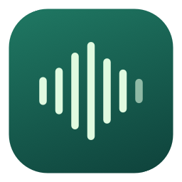

<p align="center"></p>
<h1 align="center">会声 · HuiSheng</h1>
<p align="center">在 Mac 上录制会议声音，保存到本地。</p>
<p align="center"><a href="README.md">English</a> · <strong>简体中文</strong></p>

会声将会议声音和麦克风一起录制，保存为可直接播放的 M4A 文件。使用 macOS 原生音频采集，无需账号、云端服务、API 密钥或虚拟声卡。

**早期预览版：**当前应用界面为简体中文，文档提供中英文两个版本。本版本只录制音频，不包含转写、纪要和录屏功能。

## 功能

- 录制全部系统声音，或选择一个正在运行的应用。
- 可同时录入系统默认麦克风，分别显示会议和麦克风输入音量。
- 支持暂停与继续，保存的录音不包含暂停期间的空白。
- 导出混合后的 M4A，同时保留原始音轨供恢复使用。
- 浏览、搜索、回听录音，以及在访达中定位文件。
- 关闭主窗口后，可从菜单栏管理正在进行的录音。
- 自选本地保存位置；应用不上传音频。

## 系统要求

| 项目 | 要求 |
| --- | --- |
| 操作系统 | macOS 15 或更新版本 |
| 预编译安装包 | Apple Silicon / arm64 |
| 系统权限 | 屏幕与系统音频录制；启用麦克风时还需麦克风权限 |
| 源码构建 | 带 Swift 6+ 的 Apple Command Line Tools 或 Xcode |

首版在 macOS 26.5.2、Swift 6.3.3 环境验证。尚未实测更早的受支持 macOS 版本或 Intel Mac。

## 安装

从 [v0.1.0 预览版发布页](https://github.com/chenxiachan/HuiSheng/releases/tag/v0.1.0) 下载 `HuiSheng-v0.1.0-macOS-arm64.zip`，解压后将 `会声.app` 拖到「应用程序」文件夹。

预览版使用临时签名，**尚未经过 Apple 公证**。macOS 可能拦截下载的应用；本版本也可通过源码在本机构建。

## 录制会议

1. 打开会议客户端并进入会议。
2. 在会声中选择「**全部系统声音**」，或指定会议应用。
3. 开始前按需开启或关闭「**录入我的声音**」。
4. 点击「**开始录音**」，在「系统设置 → 隐私与安全性」中允许所需权限。如果授权后仍无法采集，请退出并重新打开会声。
5. 确认会议声音与麦克风音量指示有响应。可以暂停、继续，最后点击「**结束并保存**」。

默认保存到 `~/Movies/会声`，可在录音面板或设置中更改位置。每场会议有独立文件夹，包含最终 `.m4a`、原始音轨和 `session.json` 元数据。录音列表显示当前所选保存位置中的会议。

| 快捷键 | 操作 |
| --- | --- |
| `⌘ ⇧ R` | 开始 / 结束并保存 |
| `⌘ ⇧ P` | 暂停 / 继续 |
| `⌘ ⇧ O` | 打开录音文件夹 |

## 腾讯会议、Teams、Zoom 与网页会议

会声通过 Apple **ScreenCaptureKit** 采集音频，不需要会议插件，也不调用会议平台的云端录制 API。腾讯会议、VooV Meeting、Microsoft Teams、Zoom 和网页会议的适配方式，是采集它们在 Mac 上播放的声音。

- **全部系统声音**也会包含音乐、通知和其他应用的声音。
- **指定应用模式**筛选所选应用，以及包标识符前缀匹配的辅助进程。部分客户端可能由其他进程输出音频；如果音量指示一直没有响应，请尝试全部系统声音。
- 网页会议请选择**浏览器**，暂不支持单独隔离某个浏览器标签页。

目前**尚未逐一验证腾讯会议、Teams、Zoom 的真实通话**。正式使用前，请检查两路音量指示，并做一次短录音确认。

## 录音行为与隐私

- 开始前告知参会者。会声不会在会议中发送录制通知。
- 建议佩戴耳机，避免扬声器声音被麦克风重复录入。当前没有声学回声消除功能。
- **会议软件里的静音不会关闭会声的麦克风。**如果只需要会议声音，请在开始前关闭会声的麦克风开关。
- 保持 Mac 开盖并处于唤醒状态。休眠、权限变更、音频设备切换可能中断采集；更换设备后请检查音量指示。
- 音频处理和文件导出都在本地完成。如果保存到 iCloud、Dropbox 等服务同步的文件夹，同步服务可能自行同步这些文件。
- 开始录制约需 512 MiB 可用空间；低于约 100 MiB 时，应用会尝试结束保存。导出还需要额外空间。
- 导出后仍保留原始音轨，因此总占用空间大于最终 M4A 文件；可通过访达管理文件。
- 中断后可用「**恢复导出**」尝试从可读取的原始音轨恢复。崩溃或断电后的恢复不作保证。

## 从源码构建

```bash
git clone https://github.com/chenxiachan/HuiSheng.git
cd HuiSheng
bash scripts/build-app.sh "$PWD/dist/会声.app"
open "dist/会声.app"
```

脚本会以发布模式构建 Swift 包、生成图标、组装应用并进行临时签名。没有第三方包依赖。可用 `HUISHENG_BUILD_DIR` 指定构建目录，默认是 `.build`。

## 运行验证

```bash
bash scripts/test.sh
```

验证程序可直接使用 Command Line Tools，无需完整 Xcode。使用合成音频，不访问屏幕或麦克风，包含五项检查：

1. 去除暂停间隔，并拒绝恢复时过期的样本。
2. 首个音频样本到达前暂停的边界情况。
3. 录音文件名处理和时长格式。
4. 48 kHz 双声道与延迟开始的 44.1 kHz 单声道的真实编码、混音、导出和解码，并检查暂停前后的频谱。
5. 空数据导出失败时不产生最终文件。

测试产物保存在 `.test-output/`，也可用 `HUISHENG_TEST_OUTPUT_DIR` 指定位置。长时间会议、设备热切换、系统休眠和崩溃恢复仍需更多真实场景测试。

## 实现方式

`ScreenCaptureKit → 独立 AAC 音轨 → 统一时间轴 → 本地混合为 M4A`

SwiftUI 和 AppKit 提供界面与菜单栏控制。串行媒体队列处理采集、暂停和结束。AVAssetWriter 分别编码系统声音与麦克风，再通过 AVMutableComposition 和 AVAudioMix 导出最终录音。两条音轨混合时各使用 0.5 增益，为叠加后的音量预留空间。

原始音轨采用分片 MOV 容器。最终录音先导出到临时文件，成功后再移到正式位置；会话元数据原子写入。音频模式下，屏幕样本被丢弃，不会传入文件写入器。

接口参考：[Apple ScreenCaptureKit 文档](https://developer.apple.com/documentation/screencapturekit)、[麦克风采集说明](https://developer.apple.com/videos/play/wwdc2024/10088/)。
