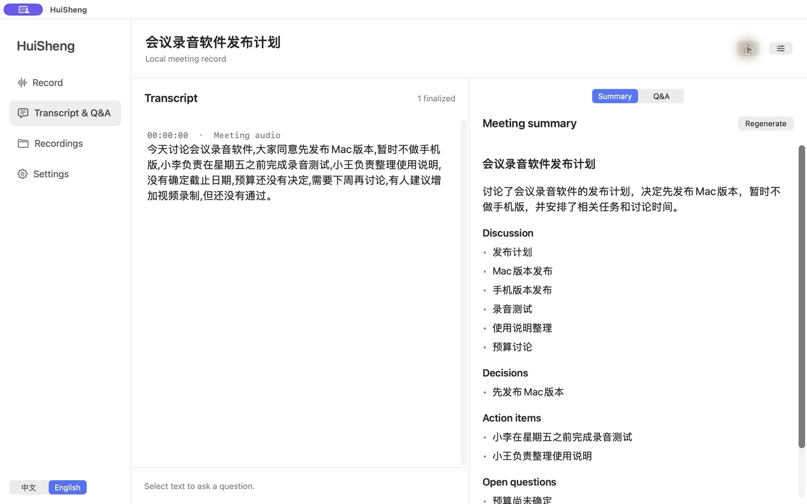

# HuiSheng · 会声

**English** · [简体中文](PRODUCT.zh-CN.md) · [User guide](../README.md)

**Record meetings on your Mac, transcribe them, read a summary, and ask questions about any passage.**

HuiSheng is a native macOS meeting recorder. It saves meeting audio and your microphone locally, transcribes with Whisper or Apple speech recognition, and uses an on-device language model after recording to generate a title, discussion points, confirmed decisions, action items, and open questions.

The transcript, summary, and follow-up questions share one workspace. Select a passage to start a discussion beside it, then return to the original quotation whenever needed. Connect your own API or a local model server, or let HuiSheng find an installed Codex or Claude Code agent.

## From recorded audio to meeting notes

- **Keep recordings local.** Capture all system audio or a selected application, optionally include your microphone, pause, play back, and export M4A.
- **Choose when to transcribe.** Watch text during the meeting or transcribe after saving. Multilingual Whisper models support automatic language detection.
- **Organize after the meeting.** Generate titles for untitled recordings while preserving names you entered. Chinese and English meetings receive summaries in their respective languages.
- **Ask about the source.** Select text to create a discussion, ask follow-up questions, and retain quotation locations and explicit context boundaries.
- **Use a simple native interface.** Larger type and instant Chinese/English switching. Reopen recordings, transcripts, summaries, and discussions locally, and export meeting notes as Markdown.

HuiSheng captures the audio meeting clients play on your Mac through the system audio APIs, without a conferencing plugin. This is the capture path for Tencent Meeting, Teams, Zoom, and browser meetings; real calls in each client still need individual testing.

## Models and requirements

Recording and Whisper transcription support macOS 15+. Whisper needs an installed `whisper-cli` and multilingual model. Apple speech recognition and automatic summaries require a compatible Mac running macOS 26; summaries also require Apple Intelligence enabled with its on-device model ready. The current download is for Apple Silicon.

Recording, local transcription, and automatic summaries require no API key. Q&A depends on the backend you choose: a local model can operate offline, while an API or a locally launched agent may contact a cloud service. Automatic summaries do not use your Q&A API or agent.

This is a preview and has not been notarized by Apple. Recognition and summaries may omit or misinterpret information; check important details against the recording.

[Download HuiSheng v0.5.0](https://github.com/chenxiachan/HuiSheng/releases/tag/v0.5.0) · [Source code](https://github.com/chenxiachan/HuiSheng) · [Release notes](RELEASE-v0.5.0.md)
