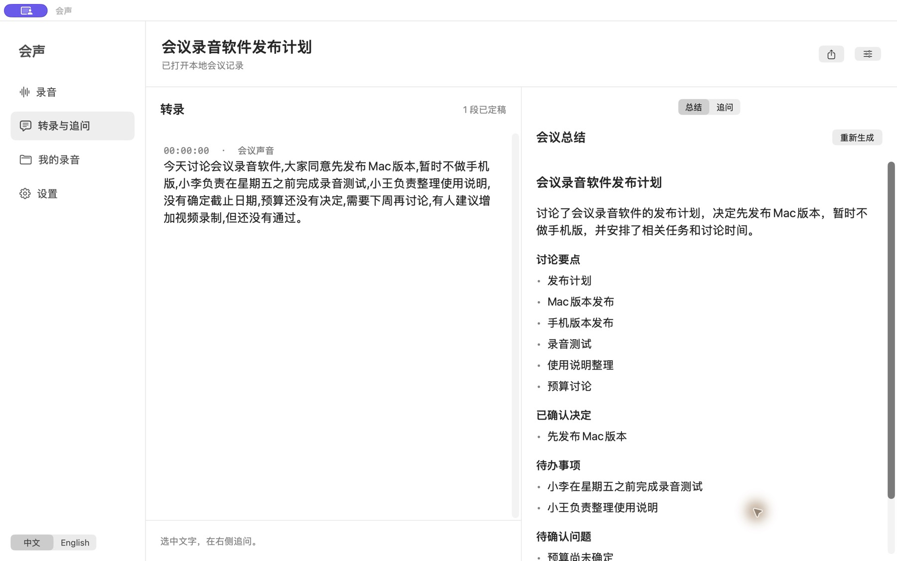

# 会声 · HuiSheng

[English](PRODUCT.md) · **简体中文** · [使用文档](../README.zh-CN.md)

**在 Mac 上录下会议，转成文字，整理总结，圈选追问。**

会声是一款原生 macOS 会议录音软件。它把会议声音和你的麦克风保存到本地，用 Whisper 或 Apple 语音模型转录；会议结束后，再由本机大语言模型自动起名，整理讨论要点、已确认决定、待办事项和待确认问题。

转录、总结和追问放在同一个工作区。读到需要进一步理解的内容，圈选一句话，就能在旁边继续提问，并回到引用的原文。你可以连接自己的 API、本机模型服务，或者让会声自动找到已安装的 Codex、Claude Code。

## 从录音到可回看的会议笔记

- **声音保存在本地。** 录制全部系统声音或指定应用，可同时录入麦克风，支持暂停、回听和 M4A 导出。
- **转录时间自己选。** 可以边录边看文字，也可以先录音、保存后再转录。Whisper 多语言模型支持自动识别语言。
- **会后自动整理。** 为未命名录音生成标题，保留手动名称；中文和英文会议分别生成对应语言的总结。
- **围绕原文追问。** 选择一段话建立讨论，继续多轮提问，保留引用位置和上下文范围。
- **简洁的原生界面。** 大字号，中文和英文即时切换；录音、转录、总结与追问可在本机重新打开，并导出 Markdown。

会声通过 Mac 的系统音频接口采集会议客户端播放的声音，无需会议插件。腾讯会议、Teams、Zoom 和浏览器会议采用这一采集方式；具体客户端的真实通话仍需分别测试。

## 模型与运行要求

录音和 Whisper 转录支持 macOS 15+；Whisper 需要已安装的 `whisper-cli` 和多语言模型。Apple 语音识别及自动会议总结需要符合相应条件的 macOS 26 Mac；总结还需要 Apple Intelligence 已开启、本地模型已就绪。当前安装包面向 Apple Silicon。

录音、本地转录与自动总结不需要 API 密钥。追问的数据处理取决于你选择的后端：本机模型可离线使用，API 或本地启动的 Agent 仍可能连接云端服务。自动总结不会使用追问的 API 或 Agent。

这是一个尚未经过 Apple 公证的预览版。语音识别与总结可能遗漏或误解信息，重要内容请回听核对。

[下载会声 v0.5.0](https://github.com/chenxiachan/HuiSheng/releases/tag/v0.5.0) · [源代码](https://github.com/chenxiachan/HuiSheng) · [更新说明](RELEASE-v0.5.0.md)
